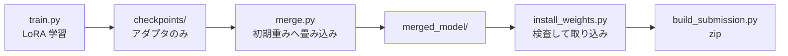

# Ubuntu の GPU マシンで Docker 学習を回す

Colab には**セッション上限**があり、20,000 ステップ（約 7 時間）を回しきれずに
9,100 ステップで切れた。GPU マシンが使えるなら、その制約が消える。

| | Colab | Docker（GPU マシン） |
|---|---|---|
| 上限 | セッションが切れる | **無し** |
| 出力 | Drive へ同期しないと消える | **ホストのディレクトリに残る** |
| 切断対策 | A〜F の仕掛けが必要 | **不要**（`--resume` だけ用意） |
| 再現性 | ノートブックの手動編集 | **イメージと引数で固定** |

`solution/train/` の 3 つで完結する。

| ファイル | 役割 |
|---|---|
| [train/Dockerfile](train/Dockerfile) | 学習用イメージ。LeRobot v0.6.0 と GPU torch |
| [train/train.py](train/train.py) | エピソード選択（H の (a)(b)）＋ 学習の実行 |
| [train/merge.py](train/merge.py) | LoRA を初期重みへ畳み込み、提出できる形にする |

## 前提

ホスト側に次が要る。**コンテナに CUDA は入れないため、ドライバだけあればよい。**

```bash
nvidia-smi                                    # ドライバが入っていること
docker run --rm --gpus all ubuntu nvidia-smi  # nvidia-container-toolkit が効くこと
```

`--gpus all` が通らない場合は
[nvidia-container-toolkit](https://docs.nvidia.com/datacenter/cloud-native/container-toolkit/latest/install-guide.html)
を入れる。

## 1. イメージを作る

```bash
docker build -t parc2026-train solution/train
```

torch は wheel に同梱された CUDA を使う。**ホストのドライバに合わせて index を変える。**

| ドライバ | 指定 |
|---|---|
| 550 以降（既定） | そのまま |
| より新しい | `--build-arg TORCH_INDEX=https://download.pytorch.org/whl/cu128` |
| GPU 無しで配線だけ見る | `--build-arg TORCH_INDEX=https://download.pytorch.org/whl/cpu` |

## 2. 学習する

```bash
mkdir -p work/train

docker run --gpus all --rm -it \
    -v "$PWD/work/train:/out" \
    -v "$HOME/.cache/huggingface:/root/.cache/huggingface" \
    parc2026-train \
    python /workspace/train.py --steps 20000 --batch-size 8
```

**HF のキャッシュをホストへマウントすること。** しないとコンテナを作り直すたびに
学習データ（6.4 GB）を取り直すことになる。

主な引数は次のとおり。既定値は Colab で回していた条件に揃えてある。

| 引数 | 既定 | 意味 |
|---|---|---|
| `--steps` | `20000` | 学習率はこの値をかけて減衰する。途中で止めると焼き鈍しが効かない |
| `--batch-size` | `8` | VRAM に合わせる。Colab の T4 では 4 が上限だった |
| `--episodes-per-task` | `5` | 全 40 タスクから選ぶ。5 を超えると転送量が 6.4 GB → 15.8 GB に跳ねる |
| `--num-workers` | `4` | 動画デコードが律速。Colab は 0 だったのでここが効く見込み |
| `--save-freq` | `500` | チェックポイントの間隔 |
| `--no-image-transforms` | — | 付けると画像拡張を切る（既定は有効） |

実行すると、まず選んだエピソードの確認が出る。

```
[train] 40 タスク × 5 本 = 200 エピソード
[train]   選んだ分の明るさ 0.086 〜 0.723
[train]   データセット全体 0.086 〜 0.723
```

**この 2 行が一致していれば、H の (b)（明るさで散らす）が効いている。**

### 中断したとき

```bash
docker run --gpus all --rm -it \
    -v "$PWD/work/train:/out" -v "$HOME/.cache/huggingface:/root/.cache/huggingface" \
    parc2026-train \
    python /workspace/train.py --resume
```

最新のチェックポイントを数値順で選び、`--config_path` を組み立てて渡す。
`load_training_state` が **step / optimizer / scheduler / RNG を全て復元**するため、
学習率スケジュールもそのまま続く。

> **`--policy.path` と `--resume` は排他である。** `_resolve_pretrained_from_cli()` が
> policy path を優先するため、両方渡すと再開が黙って無視される。
> `train.py` は再開時に `--policy.path` を付けない。

### Colab で作ったチェックポイントから続ける

Drive の `train/checkpoints/` をホストへ持ってきて、同じ構造に置けばよい。

```bash
mkdir -p work/train/smolvla_lora_all_suites
cp -r <Drive>/parc2026/<RUN_NAME>/train/checkpoints work/train/smolvla_lora_all_suites/
# 以降は --resume で続く
```

**ただし `--steps` を Colab のときと同じ値にすること。** 学習率は
`scheduler_decay_steps` で決まるので、ここがずれるとスケジュールが変わる。

## 3. マージする

**学習しただけでは提出できない。** チェックポイントには LoRA アダプタしか入っていない。

```bash
docker run --rm -it \
    -v "$PWD/work/train:/out" -v "$HOME/.cache/huggingface:/root/.cache/huggingface" \
    parc2026-train \
    python /workspace/merge.py
```

`--step` を省略すると最新を使う。途中で打ち切った場合は、学習率がどこまで
落ちているかを見てから選ぶ（[COLAB.md](COLAB.md) の「途中のチェックポイントで
打ち切るとき」の表）。**GPU は不要**なので `--gpus` は付けなくてよい。

出力は `work/train/<run-name>/merged_model/` である。

## 4. 提出物へ取り込む

```bash
work/venv310/bin/python solution/tools/install_weights.py \
    work/train/smolvla_lora_all_suites/merged_model --dry-run

work/venv310/bin/python solution/tools/install_weights.py \
    work/train/smolvla_lora_all_suites/merged_model

work/venv310/bin/python solution/tools/build_submission.py
```

`install_weights.py` が LoRA の残留・テンソル構成・必須ファイルを検査し、
既存の重みを `.bak` へ退避する。詳細は [README.md](README.md) の
「追加学習した重みへの差し替え」を参照。

## 全体の流れ



## 注意点

| 項目 | 内容 |
|---|---|
| **Python の版** | 学習側は 3.12。採点環境の 3.10 互換は `vendor_lerobot.py` が別途担保する |
| **CUDA の版** | 学習側は torch の wheel 同梱版。採点環境の CUDA 13 とは無関係 |
| **bf16** | `train.py` が起動時に GPU を見て、非対応なら fp16 へ書き換える。Colab と同じ処理 |
| **`--steps` の変更** | 学習率スケジュールが変わる。再開時は前回と同じ値にすること |
| **HF キャッシュ** | ホストへマウントしないと 6.4 GB を毎回取り直す |
