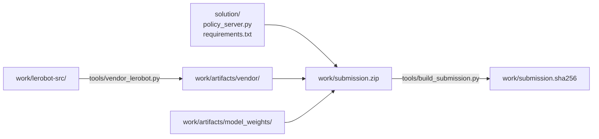

# solution/ — 提出物の実装

[docs/strategy/02_環境戦略.md](../docs/strategy/02_環境戦略.md) の**方式 A**（LeRobot の
ソースを提出物へ同梱し、採点環境の Python 3.10 で動かす）を実際に組んだものである。

**追跡するのはこのディレクトリだけ**である。重み・同梱ソース・venv・zip はすべて
`work/` 以下に出力され、git 管理外になる。下の手順で丸ごと再生成できる。

## 中身

| パス | 内容 |
|---|---|
| `policy_server.py` | `MyPolicy` を実装したポリシーサーバー（変更不可領域は未改変） |
| `requirements.txt` | 提出物の依存（確定版） |
| `requirements-dev.txt` | ローカル検証用の依存。**提出物には使わない** |
| `tools/vendor_lerobot.py` | LeRobot のソースを Python 3.10 で動く形へ書き換えて同梱する |
| `tools/install_weights.py` | Colab で追加学習したマージ済みモデルを取り込む |
| `tools/build_submission.py` | 提出用 zip を組み立て、検証し、sha256 を記録する |
| `tools/digest_submission.py` | 提出物の内容ダイジェスト。環境間の同期確認に使う |
| `tools/run_local_eval.sh` | 配布キットの評価パイプラインを提出物に対して回す（コンテナ内） |

`tools/` の Python スクリプトは**どのディレクトリから実行してもよい**。入出力は
スクリプト自身の位置から求めたリポジトリルート基準で解決する。

## 生成物の置き場（`work/`、git 管理外）

| パス | 内容 |
|---|---|
| `work/lerobot-src/` | LeRobot v0.6.0 の展開元 |
| `work/artifacts/vendor/lerobot/` | 同梱用に書き換えた LeRobot（12MB） |
| `work/artifacts/model_weights/` | 学習済み重み + VLM の設定/トークナイザ（878MB） |
| `work/venv310/` | 検証用の Python 3.10.12 venv |
| `work/submission.zip` | 提出物（918MB） |
| `work/submission.sha256` | 上の zip のハッシュ |



**コードは `solution/` が正**である。`work/` へコピーして同期させる運用にすると
必ずどちらかが古くなるため、`build_submission.py` は zip 化のときに両方から直接束ねる。

## 再生成の手順

### 1. Python 3.10 の venv を作る

```bash
export UV_CACHE_DIR="$TMPDIR/uvcache"
uv venv --python 3.10.12 work/venv310
```

採点環境と同じ 3.10.12 に合わせている。

### 2. LeRobot v0.6.0 のソースを取得して同梱する

```bash
python3 -c "
import io, tarfile, urllib.request, pathlib, shutil
url = 'https://codeload.github.com/huggingface/lerobot/tar.gz/refs/tags/v0.6.0'
data = urllib.request.urlopen(url, timeout=300).read()
dest = pathlib.Path('work'); target = dest / 'lerobot-src'
if target.exists(): shutil.rmtree(target)
with tarfile.open(fileobj=io.BytesIO(data), mode='r:gz') as tf:
    root = tf.getnames()[0].split('/')[0]; tf.extractall(dest)
(dest / root).rename(target)
"

work/venv310/bin/python solution/tools/vendor_lerobot.py \
    --python310 work/venv310/bin/python
```

`vendor_lerobot.py` は 3.12 専用の構文・API だけを書き換える。置換対象が 1 箇所で
なければ例外にするため、LeRobot のバージョンが変われば黙って壊れずに落ちる。

### 3. 重みを `work/artifacts/model_weights/` に置く

**VLM の `model.safetensors` は含めない**（VLM の重みはポリシー側の
チェックポイントに含まれている）。

| 取得元 | revision | 置き場所 |
|---|---|---|
| `lerobot/smolvla_libero_plus` | `7bb70aa5bc92b82c9239142775d3a173103567ff` | `model_weights/` |
| `HuggingFaceTB/SmolVLM2-500M-Video-Instruct`（設定とトークナイザのみ） | — | `model_weights/vlm/` |

Colab で追加学習した場合は、マージ済みモデルの中身で `model_weights/` 直下を
差し替える。`vlm/` はそのまま残す（[COLAB.md](COLAB.md) 参照）。

### 4. zip を作る

```bash
work/venv310/bin/python solution/tools/build_submission.py
```

`work/submission.zip` と `work/submission.sha256` が出力される。
ハッシュはレポートの「提出チェックポイントのハッシュ値」にそのまま使える。

### 既知の正解ハッシュ

`work/` は git 管理外なので、zip 自体は残らない。**素の重み（追加学習なし）で
組んだ提出物のハッシュをここに記録しておく**。手順 1〜4 をやり直したときに
この値と一致すれば、同じものが再生成できたと言える。

重みはいずれも `lerobot/smolvla_libero_plus` の `7bb70aa5`（追加学習なし）、
環境変数はすべて未設定（後処理は無効）である。

| 対応コミット | sha256 | サイズ |
|---|---|---|
| `51e932b` | `55d9f3031d85408527c1888c79179a338f3cf21bbcbed3d83a228134c1075cbd` | 918 MB |
| `bfbfde0` | `26e332b983a4732fa6877c6e4c458cae6676f58b20ddf085f8e9a28fbf98f5ff` | 918 MB |
| **現在** | `f80abc7bc99c2007ad88b1577e9e8e9f727e09b045132cf24fa287e7e05ea3a6` | 918 MB |

**3 つとも既定の挙動は同一である。** 差分は `policy_server.py` に
`PARC_N_ACTION_STEPS` / `PARC_BLEND_STEPS` / `PARC_EMA_ALPHA` の入口を
足したことだけで、環境変数を設定しなければ一切触らない。
バイト列が変わるためハッシュだけが変わる。

一致しない場合は、LeRobot のバージョン・重みの revision・`requirements.txt` の
いずれかが変わっている。追加学習した重みに差し替えれば当然変わるので、
そのときは行を足す。

### 推論時の後処理（既定はすべて無効）

運営 Q&A No.10 で「VLA が生成した Action を、全タスク共通のルールで整える処理」は
禁止事項に含まれないと明言されている。A/B 用の入口を環境変数で用意している。

| 環境変数 | 既定 | 何をするか |
|---|---|---|
| `PARC_N_ACTION_STEPS` | チェックポイントの値（50） | 1 回の推論で作った chunk のうち何ステップ分を実行するか。縮めると閉ループ寄りになる |
| `PARC_BLEND_STEPS` | `0`（無効） | chunk 境界の直後、何ステップかけて前の行動から移行するか |
| `PARC_EMA_ALPHA` | `0`（無効） | 行動列全体への指数平滑の係数 |

**後処理が触るのは行動 7 次元のうち 0〜5（EEF の並進・回転）だけである。**
6 次元目のグリッパは逆正規化統計の min/max がちょうど ±1、std 0.999 の
バンバン制御であり、均すと中間値になって掴めなくなる。

## 追加学習した重みへの差し替え

Colab で学習してマージしたモデルを持ち帰ったあとの手順である。
配布ノートブックの**マージセル**が出す `..._merged/` を入力に取る。

```bash
# 1. 取り込む前に検査だけする（何も書き換えない）
work/venv310/bin/python solution/tools/install_weights.py ~/Downloads/merged_model --dry-run

# 2. 問題なければ取り込む
work/venv310/bin/python solution/tools/install_weights.py ~/Downloads/merged_model

# 3. zip を作り直す（組み立て直後に中身を検証する）
work/venv310/bin/python solution/tools/build_submission.py
```

**マージセルの出力には `vlm/` が含まれない。** SmolVLM の設定とトークナイザは
今ある `model_weights/vlm/` から引き継ぐ必要があり、`install_weights.py` が
これを機械的に行う。手作業でコピーすると必ず取りこぼす。

取り込み前に次を検査し、1 つでも引っかかれば**書き換えずに中止する**。

| 検査 | 引っかかると何が起きるはずだったか |
|---|---|
| 必須ファイルが揃っているか | 採点環境でモデルロードに失敗して 0 点 |
| `config.json` の `use_peft` が偽か | LoRA 未マージのまま提出 |
| `model.safetensors` に `lora_` が残っていないか | 同上 |
| テンソル構成が既存と一致しているか | `MyPolicy` が重みを読めない |

**既存の重みは削除せず `work/artifacts/model_weights.bak/` へ退避する。**
追加学習の結果が悪ければ、この 1 行で素の重みへ戻せる。

```bash
rm -rf work/artifacts/model_weights && \
  mv work/artifacts/model_weights.bak work/artifacts/model_weights
```

`build_submission.py` は zip を書いたあとに開き直し、エントリの集合の一致、
`policy_server.py` と `requirements.txt` の内容一致、`model_weights/vlm/` と
`vendor/lerobot/` の存在を確認する。**過去に「zip の中の `requirements.txt` だけ
古い」という事故を起こしているため**、ここで機械的に潰す。

## 検証

**ローカル（macOS）では採点環境を再現できない。** CUDA が無く、`torchvision` は
CUDA 13 ビルドのため import できない。検証は Docker コンテナで行う。

```bash
docker build -t parc2026 .
docker run -it --rm -v "$PWD/work:/host_work" parc2026
```

コンテナ内では、本番と同じく `--system-site-packages` 付きの提出物専用 venv を作る。
配布キットの依存は `/workspace/venv` にあるため、パスを足して同じ階層を再現する。

```bash
/usr/bin/python3.10 -m venv --system-site-packages /opt/subvenv
echo /workspace/venv/lib/python3.10/site-packages \
  > /opt/subvenv/lib/python3.10/site-packages/_kit_site_packages.pth
/opt/subvenv/bin/pip install -r /sub/requirements.txt

# ローカル検証時のみ。配布 Docker の torch は +cpu のため、
# PyPI の CUDA 13 ビルドの torchvision は import できない。
/opt/subvenv/bin/pip install --no-deps --force-reinstall \
  --index-url https://download.pytorch.org/whl/cpu torchvision==0.26.0

cd /workspace && /opt/subvenv/bin/python validate_submission.py /sub/submission.zip
```

> **`HF_HOME` を空ディレクトリに向け、`HF_HUB_OFFLINE=1` を立てて検証すること。**
> そうしないと、採点環境（通信遮断）でだけ起きる Hub アクセスの失敗を見逃す。

環境をまたいだときは、内容が一致しているかを確認する。

```bash
work/venv310/bin/python solution/tools/digest_submission.py --per-entry
```

## 現在の状態

| 項目 | 結果 |
|---|---|
| Python 3.10.12 での import・重みロード | OK（クリーンキャッシュ・完全オフラインで 17 秒） |
| `requirements.txt` のみのクリーン venv で起動 | OK（`pip check` クリーン、torch/numpy 不変） |
| `/health` → `/reset` → `/act` | OK（`(7,) float32`、NaN なし） |
| action chunk のキャッシュ | OK（重い推論 1 回 → 以降 50 ステップはキャッシュ） |
| `validate_submission.py`（静的） | PASS（errors=0, warnings=0） |
| 評価パイプラインが実タスクで回るか | OK（`compe.t1` の 4 タスクを認識、最後まで完走） |
| 観測変換の正しさ | OK（`lerobot/envs/libero.py` と配布キットの突き合わせで確認） |
| **推論 10 秒以内** | **OK**。Colab T4 で 0.85 秒（CPU 2 コアでは 23.4 秒） |
| **起動 120 秒以内** | **OK**。Colab T4 で重みロード 41.5 秒 |
| **CUDA 13 の torchvision が import できるか** | **未検証**。Colab の CUDA は 13 ではない。CUDA 12 では動作を確認 |
